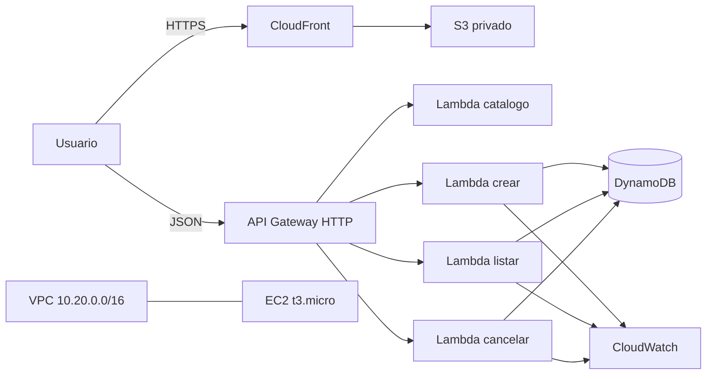
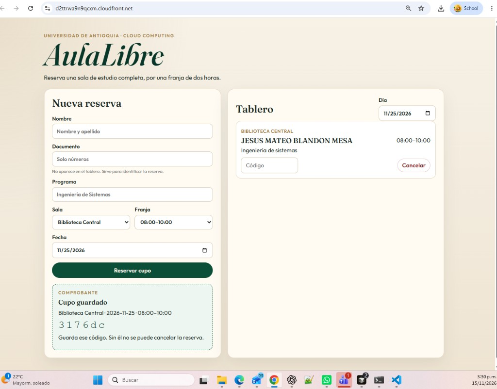
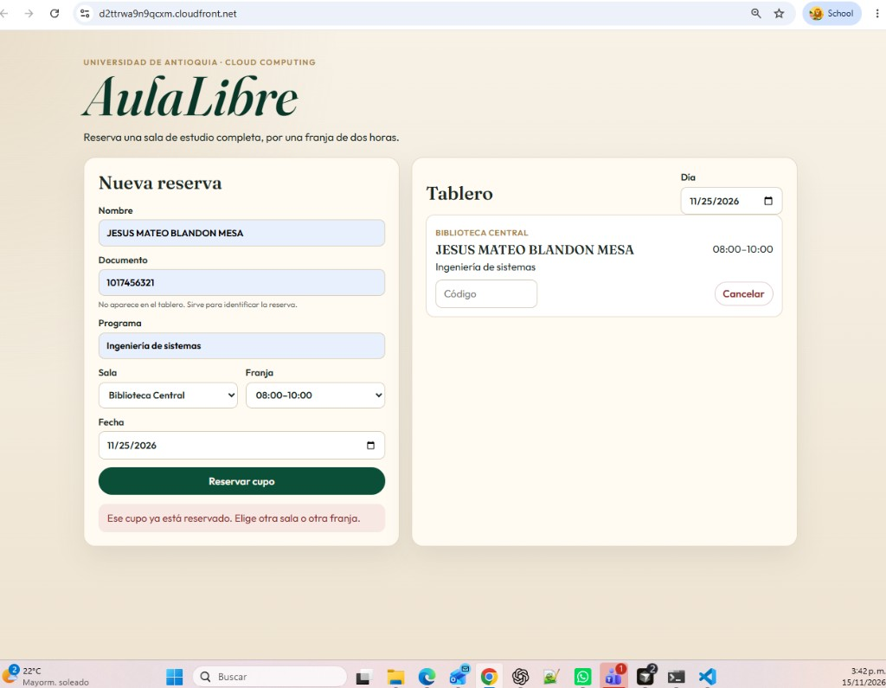
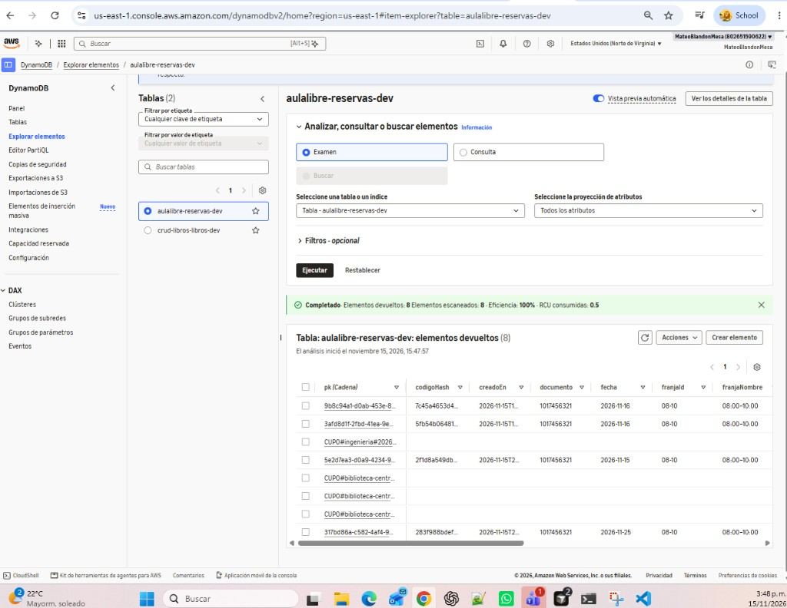
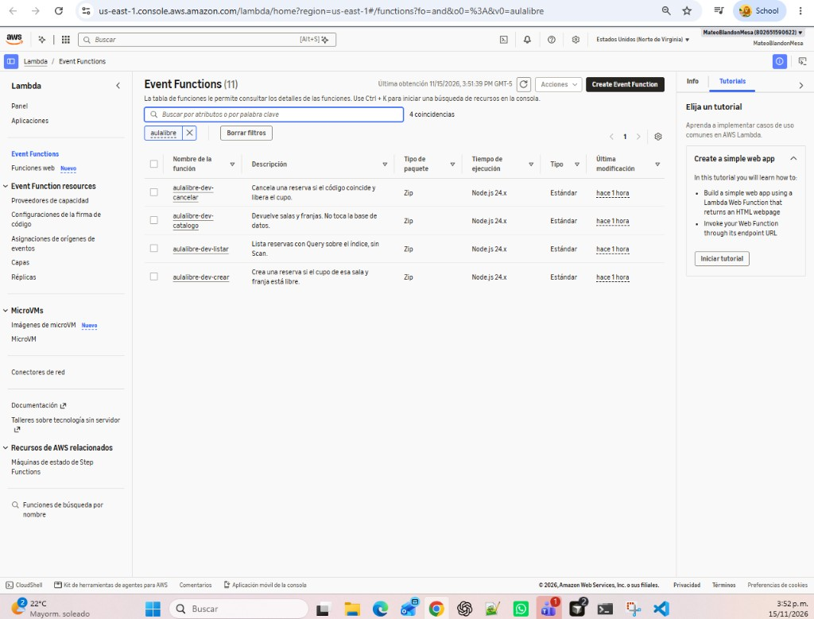

# AulaLibre — Documento técnico

**Curso:** Cloud Computing — Juan Pablo Arango  
**Institución:** Universidad de Antioquia, 2026  
**Integrantes:** Andrés Espejo y Mateo Blandón  
**Fecha de elaboración:** 15 de noviembre de 2026  
**Entrega:** 29 de noviembre de 2026  

El grupo quedó conformado por dos personas. La solución se despliega una sola vez, en la cuenta gratuita de AWS de Mateo, región `us-east-1`.

## 1. Descripción general

AulaLibre es una aplicación web para reservar salas de estudio. Una persona elige sala, fecha y franja de dos horas, deja su nombre, documento y programa, y recibe un código de cancelación. El tablero del día muestra quién ocupó cada sala. El documento no se publica. Para cancelar hace falta ese código.

El flujo que pide el enunciado queda así:

1. El navegador carga el sitio estático.
2. El formulario envía `POST /reservas` a API Gateway.
3. La función `crear` valida los datos y escribe en DynamoDB.
4. La API responde `201` con el código, o `409` si ese cupo ya existía.
5. El tablero vuelve a leer con `GET /reservas?fecha=...`.

Hay cuatro salas (`biblioteca-central`, `bloque-21`, `ingenieria`, `ciencias-exactas`) y cuatro franjas (`08-10`, `10-12`, `14-16`, `16-18`). Cada combinación de sala, fecha y franja admite una sola reserva.

## 2. Arquitectura

El diagrama editable está en [`arquitectura.drawio`](arquitectura.drawio). Se abre en [diagrams.net](https://app.diagrams.net/).



La Lambda **no** está dentro de la VPC. DynamoDB se consume por la red pública de AWS, con el rol de la función. Meter la función en la subred pública no le daría salida a internet: Lambda ignora la IP pública de la instancia y exigiría un NAT Gateway, que cuesta alrededor de 32 USD al mes antes de contar el tráfico. La VPC cumple el requisito de red del curso y sostiene la EC2 de demostración. El tráfico de los usuarios no pasa por esa máquina.

## 3. Servicios y justificación

| Servicio | Uso en AulaLibre | Por qué este y no otro |
| --- | --- | --- |
| Amazon S3 | Guarda `index.html`, `styles.css`, `app.js` y `config.js` | El enunciado pide almacenamiento de objetos para el frontend. El bucket bloquea el acceso público. |
| Amazon CloudFront | Única puerta HTTPS del sitio, con Origin Access Control | Una cuenta nueva rechaza buckets públicos. CloudFront firma las lecturas. El dominio del proyecto es el de CloudFront (`https://dxxxx.cloudfront.net`). |
| API Gateway HTTP API | Rutas `/salas` y `/reservas` | Es el mismo tipo de API del laboratorio 3 y cuesta cerca de 1 USD por millón de llamadas, frente a 3,50 USD de la API REST. |
| AWS Lambda | `catalogo`, `crear`, `listar`, `cancelar` | Cuatro funciones Node.js 24 en Graviton (`arm64`), 128 MB y 10 s. Cada una tiene su rol. |
| Amazon DynamoDB | Tabla `aulalibre-reservas-dev` | Capacidad provisionada, 5 RCU y 5 WCU en la tabla y otras 5/5 en el índice. Cabe en los 25 RCU y 25 WCU permanentes de la capa gratuita. |
| Amazon VPC | `10.20.0.0/16`, subred pública `10.20.1.0/24`, Internet Gateway | Cumple el módulo de redes. No hay subred privada ni NAT. |
| Amazon EC2 | `t3.micro`, Amazon Linux 2023, sin puertos de entrada | En esta cuenta el plan gratuito no acepta `t2.micro`. `t3.micro` sí aparece como tipo elegible. No tiene rol IAM ni llave SSH. Después de la captura se apaga con `scripts/apagar-ec2.ps1`. |
| IAM | Un rol por función | Mínimo privilegio, más estricto que el rol compartido del laboratorio 3. |
| Amazon CloudWatch | Logs con retención de 7 días, tres alarmas de errores, una alarma de costo y un tablero | Observabilidad pedida por el curso, sin métricas personalizadas de pago. |
| AWS CloudFormation | Generado por Serverless Framework | Un solo `serverless deploy` crea y versiona la pila `aulalibre-dev`. |

Route 53 no entra en el diseño. Una zona hospedada cuesta cerca de 0,50 USD al mes y el dominio en sí se paga aparte. El nombre público es el de CloudFront, que ya es un dominio HTTPS administrado por AWS.

## 4. Diseño de datos

Una sola tabla. La clave de partición se llama `pk`.

| Ítem | `pk` | Para qué existe |
| --- | --- | --- |
| Reserva | UUID | Los datos de la persona, la sala, la franja y el hash del código |
| Cupo | `CUPO#<sala>#<fecha>#<franja>` | Candado del horario. Si el `pk` ya existe, la transacción falla |

La reserva también lleva `tipoLista = reserva` y `orden = <fecha>#<sala>#<franja>`. Esas dos claves alimentan el índice `listar-index`. El ítem de cupo no tiene `tipoLista`, así que no aparece en el tablero.

`crear` escribe los dos ítems con `TransactWriteItems` y `attribute_not_exists(pk)`. Las dos escrituras se confirman juntas o no se confirma ninguna. Dos personas que pidan el mismo cupo al mismo tiempo no pueden ganar las dos: la segunda recibe `409`.

`listar` hace `Query` sobre `listar-index`, filtrando por el día con `begins_with(orden, fecha)`. No hay `Scan`. El laboratorio 3 dejó claro que un `Scan` se cobra por toda la tabla; aquí el patrón de lectura es siempre "las reservas de un día", y el índice existe para esa pregunta.

`cancelar` lee la reserva, compara el SHA-256 del código y, si coincide, borra la reserva y el cupo en otra transacción. El tablero nunca recibe el documento ni el código. En CloudWatch solo se registran el nombre del error y la operación, no el cuerpo de la petición.

La capacidad es provisionada a propósito. En el laboratorio 3 usamos `PAY_PER_REQUEST` porque el tráfico era de prueba y el enunciado no exigía quedarse en la capa gratuita. Aquí 10 RCU y 10 WCU en total siguen por debajo de los 25 RCU y 25 WCU que DynamoDB no cobra. Para una sustentación sobra: una escritura de esta reserva pesa mucho menos de 1 KB, así que gasta 1 WCU por ítem.

## 5. Seguridad

- El bucket no es un sitio web público. La política solo permite `s3:GetObject` al servicio `cloudfront.amazonaws.com` y solo si el origen es el ARN de esta distribución.
- Cifrado SSE-S3 en el bucket.
- `catalogo` no tiene permisos de DynamoDB. `crear` solo tiene `PutItem`. `listar` solo tiene `Query` sobre el ARN del índice, no sobre la tabla. `cancelar` solo tiene `GetItem` y `DeleteItem`. Ningún rol puede `DeleteTable`, `Scan` ni tocar otro recurso.
- La EC2 no tiene rol de instancia, no tiene par de llaves y su grupo de seguridad no abre puertos de entrada. La única regla de salida apunta a `127.0.0.1`, porque CloudFormation exige al menos una regla de salida; no habilita tráfico real.
- CORS de la HTTP API está abierto (`*`) porque la URL de CloudFront solo existe después del despliegue. El cuerpo aceptado se corta en 4 KB y las reglas de validación viven en `backend/dominio.js`, cubiertas por `npm test`.
- No hay autenticación de usuarios. El código de cancelación evita que cualquiera borre una reserva ajena desde el tablero. Para un sistema real el paso siguiente sería Cognito; no lo incluimos para no sumar un servicio que esta entrega no exige.

## 6. Observabilidad y costos

Cada función escribe en su grupo `/aws/lambda/aulalibre-dev-*`, con retención de 7 días para no acumular logs. El tablero `aulalibre-dev` muestra invocaciones, errores y la duración p95 de `crear`, `listar` y `cancelar`. Tres alarmas pasan a estado ALARM si alguna de esas funciones suma un error no controlado en cinco minutos. Un `400` o un `409` no disparan la alarma: son respuestas de negocio, no fallos de la función.

La alarma `aulalibre-dev-costo-estimado` observa `AWS/Billing` `EstimatedCharges` y cambia de estado si el mes supera 1 USD. Hay que activar **Receive Billing Alerts** en la consola de facturación; si no, la métrica no existe y la alarma se queda en `INSUFFICIENT_DATA`.

### Estimación mensual

Supuestos de la sustentación: unos pocos miles de llamadas, el sitio de menos de 1 MB, la EC2 encendida solo el tiempo de la captura y luego apagada.

| Recurso | Supuesto | Dentro de la capa gratuita de una cuenta nueva |
| --- | --- | --- |
| Lambda | 128 MB, menos de 1 s, muy por debajo de 1 millón de llamadas y de 400.000 GB-segundo | 0 USD. Esta franquicia es permanente. |
| API Gateway HTTP | Miles de llamadas | 0 USD durante los primeros 12 meses si la cuenta aún incluye el millón de llamadas; si no, cerca de 0,01 USD. |
| DynamoDB | 10 RCU + 10 WCU y unos KB de datos | 0 USD. Los 25 RCU, 25 WCU y 25 GB son permanentes. |
| S3 | Menos de 1 MB y pocas lecturas | 0 USD. |
| CloudFront | Price Class 100, megabytes de salida | 0 USD en los primeros 12 meses (1 TB y 10 millones de requests). Después, centavos. |
| VPC, subred, Internet Gateway | Siempre creados | 0 USD. |
| EC2 `t3.micro` | Apagada casi todo el mes | 0 USD mientras la cuenta la trate como tipo de capa gratuita. Encendida todo el mes, fuera de esa franquicia, se acerca a 8–12 USD sumando la IPv4 pública. Por eso se apaga. |
| CloudWatch | 4 alarmas, 1 tablero, logs de una demo | 0 USD (10 alarmas y 3 tableros entran en la franquicia). |
| NAT Gateway | No se crea | Se evita un cargo de unos 32 USD al mes. |
| Route 53 | No se crea | Se evita la zona de unos 0,50 USD al mes. |

La cifra que debe verse en la calculadora, con la EC2 limitada a unas pocas horas y el resto de los servicios en uso de demostración, queda en **0 USD o en unos pocos centavos**. La captura de la calculadora se pega al final de este documento antes de entregar. El instructivo de qué servicios marcar está en la sección 8.

## 7. Infraestructura como código

`serverless.yml` describe la API, las funciones, los roles, la tabla, el bucket, CloudFront, la VPC, la EC2, las alarmas y el tablero. Serverless Framework genera la plantilla de CloudFormation y la publica como pila `aulalibre-dev`.

`scripts/deploy.ps1` despliega la pila, escribe la URL real en `frontend/config.js`, sincroniza el bucket e invalida la caché de CloudFront. `scripts/borrar.ps1` vacía el bucket antes de `serverless remove`, porque CloudFormation no borra un bucket con objetos.

## 8. Evidencias

### 8.1 Reserva creada

Sitio en CloudFront con el comprobante y la reserva en el tablero. Código de esta captura: `3176dc`.



### 8.2 Cupo ocupado

El mismo horario, enviado otra vez, responde que el cupo ya está reservado.



### 8.3 DynamoDB

Exploración de la tabla `aulalibre-reservas-dev`. El código de cancelación queda como `codigoHash`. Los ítems `CUPO#...` son el candado del horario.



### 8.4 Funciones Lambda

Las cuatro funciones del proyecto: `aulalibre-dev-cancelar`, `aulalibre-dev-catalogo`, `aulalibre-dev-listar` y `aulalibre-dev-crear`.



### 8.5 Evidencias que faltan

Pegar las capturas restantes en este documento antes de entregar:

1. El rol de `listar`, donde solo aparece `dynamodb:Query` sobre el índice.
2. VPC, subred pública, Internet Gateway y grupo de seguridad sin entrada.
3. Instancia EC2 `aulalibre-demo`. Enseguida apagarla.
4. Tablero de CloudWatch `aulalibre-dev` después de usar el formulario.
5. Calculadora de precios de AWS con el total mensual. Cargar estos servicios en `us-east-1`:
   - EC2: 1× `t3.micro`, 8 horas (no 730), 8 GB gp3.
   - Lambda: 10.000 solicitudes, 128 MB, 200 ms.
   - API Gateway HTTP API: 10.000 solicitudes.
   - DynamoDB provisionado: 10 RCU, 10 WCU, 1 GB.
   - S3 Standard: 1 GB, 10.000 GET.
   - CloudFront: 1 GB de salida, Price Class 100.
   - CloudWatch: 4 alarmas y 1 GB de logs.
   - Activar en la calculadora la opción de capa gratuita, si aparece, y capturar el total.

El video (1–3 minutos) muestra el sitio desplegado: abrir CloudFront, reservar, chocar con el cupo ocupado, cancelar con el código y, unos segundos, la tabla y el tablero de CloudWatch.

## 9. Cómo ejecutar el flujo

```bash
# Crear
curl -X POST "$API/reservas" -H "Content-Type: application/json" -d "{\"nombre\":\"Ana López\",\"documento\":\"1017250\",\"programa\":\"Ingeniería de Sistemas\",\"sala\":\"biblioteca-central\",\"franja\":\"08-10\",\"fecha\":\"2026-11-20\"}"

# Tablero de ese día
curl "$API/reservas?fecha=2026-11-20"

# Cancelar
curl -X DELETE "$API/reservas/<id>" -H "Content-Type: application/json" -d "{\"codigo\":\"<codigo>\"}"
```

La colección `postman/AulaLibre.postman_collection.json` trae las mismas llamadas.

## 10. Conclusiones

- Una aplicación pequeña ya obliga a decidir red, permisos y costo juntos. El NAT Gateway y el bucket público eran los dos atajos caros o inseguros, y los dos se evitaron.
- Separar el rol por función hace visible el mínimo privilegio: la función que solo lista no puede borrar, y la que solo entrega el catálogo ni siquiera ve la tabla.
- El cupo como ítem con condición dentro de una transacción resuelve el doble reserva sin un `Scan` previo y sin una condición de carrera.
- La EC2 del enunciado puede existir y permanecer apagada. El servicio que usan las personas es serverless y el costo fijo de tenerla encendida no aporta al flujo.
- Lo que sigue después de desplegar es operativo: capturas, calculadora, video y apagar la instancia. El código y la plantilla ya describen la solución completa.
